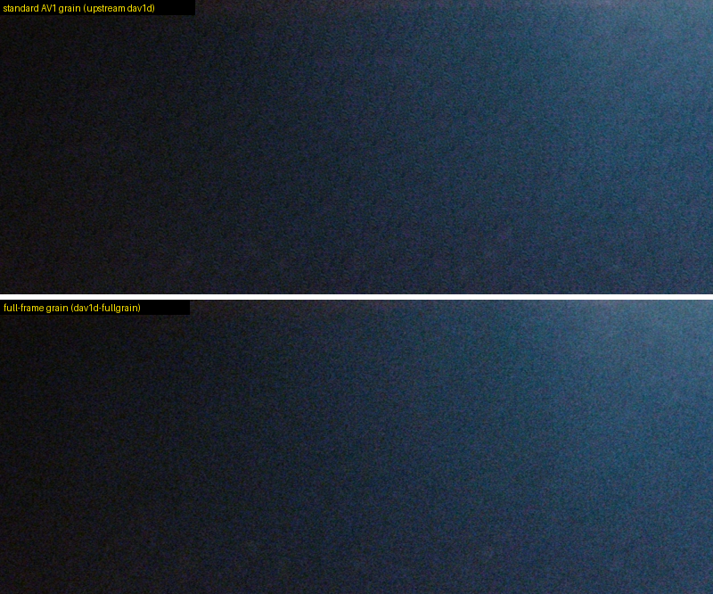
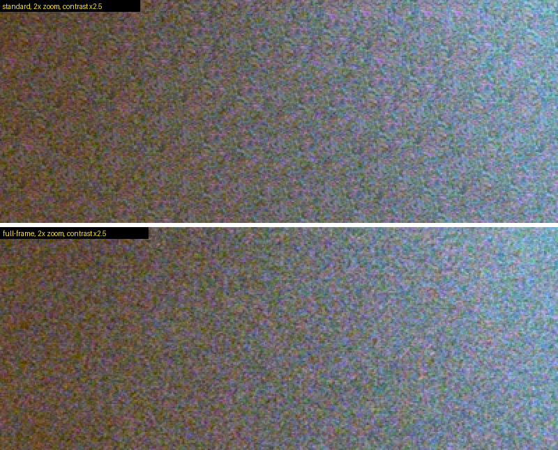
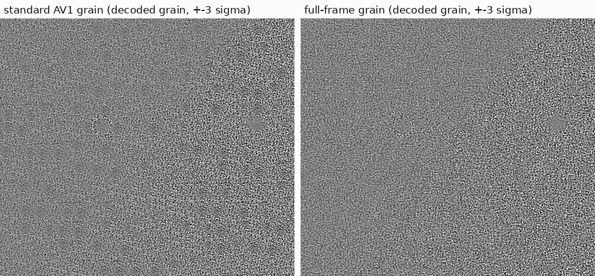
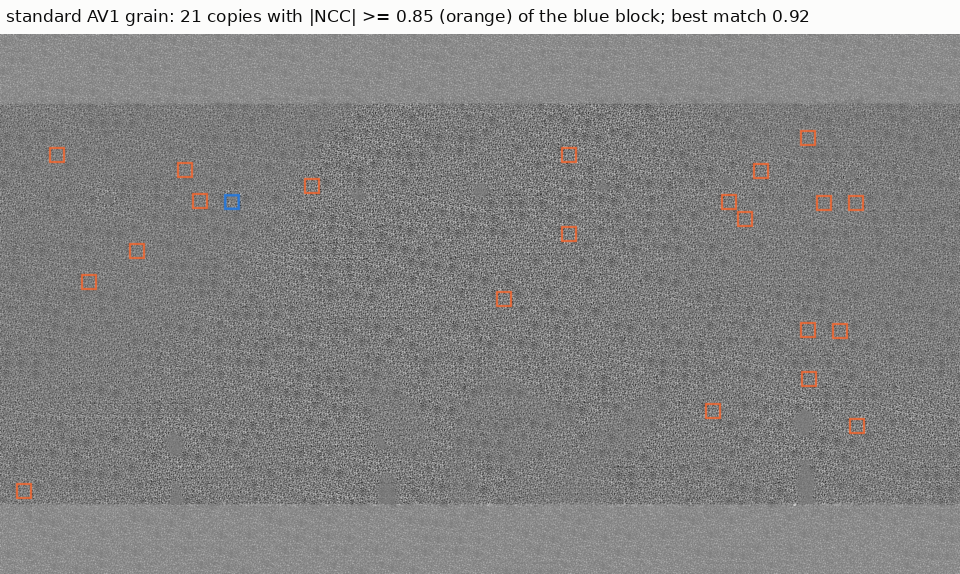
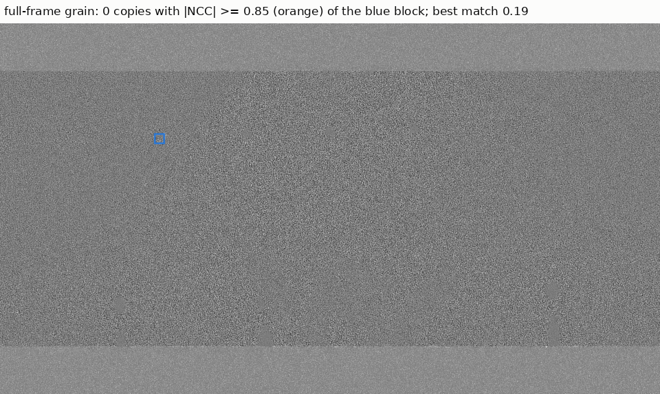
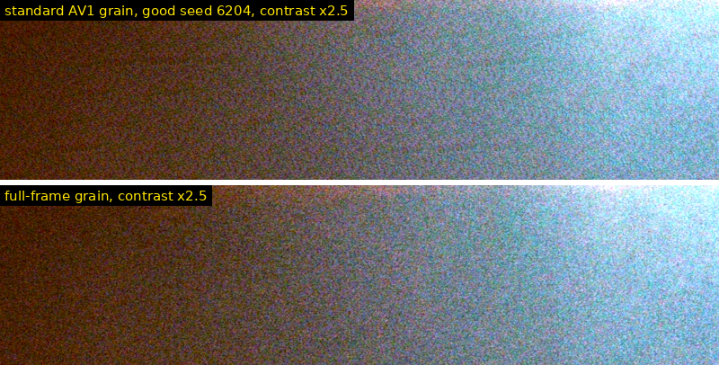
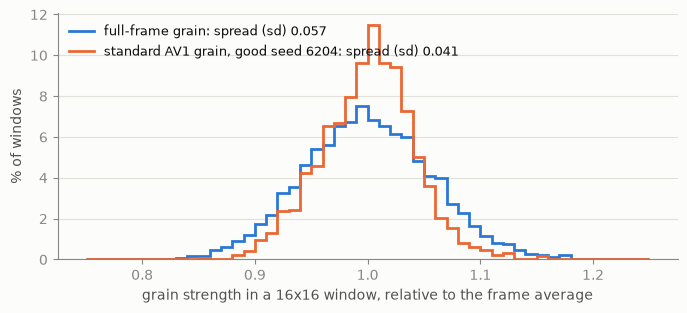
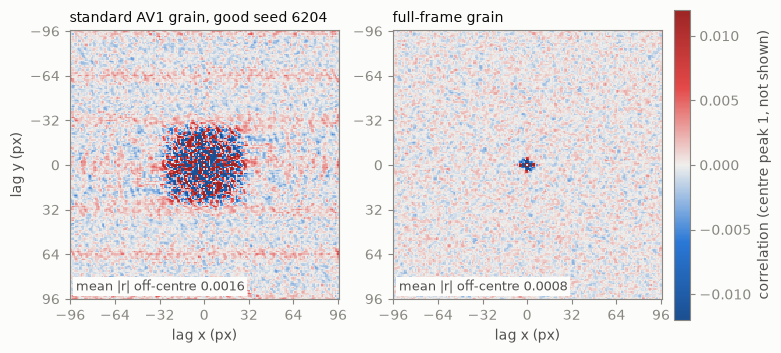
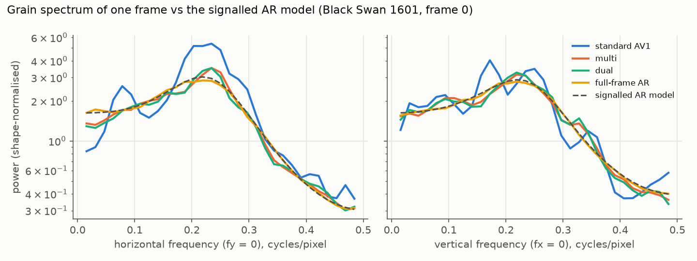
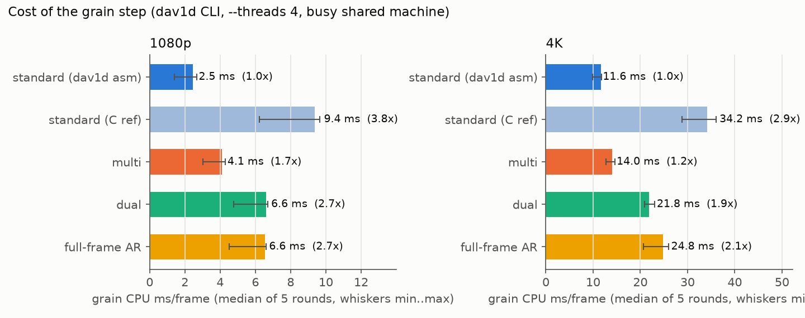

# av1-fullgrain

**Can't get the grain in your AV1 encodes to feel like film?** The encode
looks right, and the grain still looks a little off: a faint, repeating
texture that you can't unsee once you've spotted it. Your encoder settings
may not be the problem. To draw AV1 grain, a player makes one small patch of
grain for each frame and copies it all over the picture, because that's what
the AV1 standard prescribes.

**av1-fullgrain draws the grain over the whole frame instead,** so it is
random everywhere, like grain on real film. It uses the grain settings
already stored in your files, so there's nothing to re-encode.

- **No copies.** With standard AV1 grain, 92-97 % of the 32x32-pixel squares
  of grain in a frame have a near-identical copy somewhere else in the same
  frame. With full-frame grain, none do.
- **Your existing files.** Any AV1 video with film grain, from SVT-AV1,
  libaom or rav1e. Video without film grain plays exactly as before.
- **Your players.** mpv, ffmpeg and other players that use the system's AV1
  decoder on Linux and macOS, plus a player for web pages. Windows
  instructions exist but haven't been tested.
- **The cost.** The AV1 has to be decoded in software, and full-frame grain
  adds about 30-50 % to the decoder's CPU time.

For players you can't change, such as TVs, phones and hardware decoders,
**av1-grain-seed** replaces unlucky grain seeds in a file in a few minutes,
without re-encoding. The grain still repeats, but it looks as good as
standard AV1 grain can.


*The same frame and the same grain settings, contrast stretched 2.5x so the
pattern is easy to see. Top: standard AV1 grain. Bottom: full-frame grain.
This file has an unlucky grain seed, which makes the pattern stronger than
usual ([more below](#comparison)).*

## What's here

| | |
|---|---|
| [decoder/](decoder/README.md) | **The decoder**: [dav1d](https://code.videolan.org/videolan/dav1d), the AV1 decoder inside ffmpeg, mpv and most players, with full-frame grain. It replaces the system's copy of dav1d. It lives in its own repository, [dav1d-fullgrain](https://github.com/divergentnn/dav1d-fullgrain), included here as a git submodule. |
| [browser/](browser/README.md) | **A player for web pages.** The browser decodes the video and the grain is drawn on top, on the GPU or in WebAssembly, identical to the decoder's. |
| [tools/av1-grain-seed](tools/av1-grain-seed/README.md) | **The seed fixer**, for the standard grain of existing files. |
| [tools/av1grain](tools/av1grain/README.md) | Makes the grain-free copy and grain file that the browser player needs. |
| [gpu/](gpu/README.md) | **The GPU renderer**: full-frame grain drawn on the GPU (Vulkan, Metal, DX12) after any decoder, hardware decoders included. A command line tool, and libraries for C and Rust. Same pictures as the decoder, bit for bit. |
| [install/](#install) | Install guides for each system and player. |

Planned, not written yet: full-frame grain on the GPU inside mpv (libplacebo).

## Why standard AV1 grain repeats

Film grain is expensive to compress. So AV1 encoders such as SVT-AV1 and
libaom remove the grain before encoding and store a short description of it
instead: how coarse it is, and how strong at each brightness. The player
makes new grain from that description. To keep this cheap, the AV1 standard
tells it to:

- make one grain patch per frame, **82x73 pixels**;
- cover the frame with 32x32-pixel squares, each cut from that patch at one
  of only **256 positions**.

So the same few thousand grain dots appear hundreds of times in every frame.
On grainy films you can see a faint repeating texture: diagonal streaks, a
32-pixel grid, the same speckle in many places.

av1-fullgrain makes the grain for the whole frame at once, from the same
description. The grain has the size, strength and character the encoder
asked for, without the copies and without seams between squares.

## Comparison

A frame from *Black Swan* (stage haze), 1080p 10-bit AV1 with film grain. Both
halves come from the same file with the same grain settings; only the way the
grain is drawn differs.

This file has an unlucky grain seed (the random number that the grain patch
is made from). Its patch has a visible blotch, and standard AV1 grain repeats
the blotch across the whole frame. Full-frame grain doesn't use a patch, so
no seed can make a pattern.

At 1:1:



Contrast stretched 2.5x, where the repeats are easy to see:


Zoomed 2x:



With an ordinary seed, standard grain repeats just as much; it's only harder
to see. Below is a second Black Swan stage frame encoded with an ordinary
seed. It shows the grain alone (the frame decoded with grain, minus the frame
decoded without), contrast stretched:



A map of the copies. For one 32x32 square of grain (blue), every place in the
same frame where the grain nearly matches it is outlined in orange (a
correlation of 0.85 or more, where 1 would be an exact copy):




### Even a good seed repeats

A better seed removes the blotch, but not the copies. Below is the bad-seed
frame from the top of this section with the seed that
[av1-grain-seed](tools/av1-grain-seed/README.md) puts there instead: 6204,
which rates better than 99 % of all seeds for this frame's grain settings.
Standard grain with that good seed, against full-frame grain, at 1:1:


Contrast stretched 2.5x:



The good seed gives an even texture, and that is its problem: it is more
even than film grain. Measured on the grain alone (the same grain settings
on a flat grey frame):

- **Still copied.** Every 32x32 square of the good-seed frame has a
  near-copy elsewhere in the same frame. The median best match is 0.98, and
  100 % of squares have a match above 0.9, just like the bad seed (0.97,
  100 %). Full-frame grain: 0.20, and 0 %.
- **Too even.** Real grain is a little stronger in some places than in
  others. Measured in 16x16 windows, grain strength varies by 4.1 % with the
  good seed (standard deviation), against 5.7 % for full-frame grain, which
  has the natural variation of the encoder's grain model (the bad seed:
  6.8 %). At the 16-pixel scale, the good seed has 42 % less coarse
  structure than the model.



- **Echoes.** The chart below shows how much the grain at one point
  resembles the grain at points nearby (its autocorrelation). For full-frame
  grain, that's only the short, close-range link that the grain model
  describes. Copied grain adds echoes out to about 30 pixels, where two
  squares were cut from overlapping parts of the same patch, and bands every
  32 rows from the rows of squares:



A seed only decides which patch gets copied. For natural, random grain, the
grain has to be made for the whole frame.

## Numbers

Measured on four films (two 1080p 10-bit, one 1080p 8-bit, one 4K 10-bit),
8 frames each (4 for the 4K film):

| | standard AV1 | full-frame |
|---|---:|---:|
| 32x32 squares of grain with a near-copy (correlation above 0.9) elsewhere in the same frame | 92-97 % | **0 %** |
| how closely each square's best match elsewhere in the frame resembles it (median; unrelated random grain scores 0.17-0.37) | 0.95-0.97 | **0.17-0.37** |
| how far each frame's grain texture is from the encoder's description (spectrum error, dB RMS) | 1.3 | **0.07-0.11** |
| grain strength that rises and falls every 32 pixels | ±9-11 % | **±1-2 %** (measurement noise) |
| CPU time for the grain, x86-64 with AVX2 (1080p / 4K) | 1x | **2.7x / 2.1x** |
| CPU time for the whole decode (1080p / 4K) | | **+49 % / +32 %** |




The spectrum chart shows one frame. Standard grain inherits the random
quirks of its one small patch, so every frame's grain texture is off by
about 1.3 dB, differently in each frame. Full-frame grain follows the
encoder's description.

The CPU cost was measured with 4 threads on a Ryzen 5 9600X that was busy
with other work. Over 5 rounds, the grain cost ranged from 2.3x to 4.0x at
1080p and from 2.1x to 2.35x at 4K. Within each round the ratio was steadier
than the times themselves.



A 4K 10-bit film decodes at 43 fps on 4 threads, against 57 fps with standard
grain. On Apple Silicon the output is identical (checked in CI and under
emulation), but the speed hasn't been measured on a real Mac yet; CI prints
timings for `macos-14`.

## How it works

**Inputs, all as signalled.** The same 2048-entry Gaussian table and shifts,
the same AR coefficients with the same integer rounding and clipping, the
same piecewise-linear intensity scaling, and the same chroma-from-luma AR
term.

**Full-frame mode.**
- White noise is a stateless hash of the frame seed and the pixel position.
- The AR recursion runs over the whole frame.
- To keep dav1d's parallel row tasks, each band of 4x32 rows restarts the
  recursion 16 rows above itself. Because the noise is a hash, the warm-up
  rows reproduce the rows above, and the restart is invisible: at most 0.7 %
  of the grain RMS in luma.
- SIMD: the AR filter's left-neighbour taps make every row a serial
  dependency chain. 16 rows are therefore computed in lockstep in a skewed
  memory layout, one vector lane per row, where every filter tap is a single
  vector load. This is done in AVX2 on x86-64 and NEON on arm64.
- Results are bit-identical to the C code on both architectures.

**Other modes** come from the same study. They keep the 32x32 blocks but mix
more grain:
- `dual` adds two block layers on grids offset by 16 px.
- `multi` uses 16 templates per frame and per-block sign and 180° rotation.

`dual` removes the strong repeats at about the same cost as `full`. `multi`
is cheaper and only removes exact copies. `full` is the default.

## Install

> **This is not a conformant AV1 decoder.** The AV1 spec defines the grain
> pixel by pixel. With this decoder, AV1 *with film grain* decodes differently
> from every other decoder, although the grain is statistically the same.
> Video without film grain is decoded exactly like upstream dav1d. Use it for
> watching, not for conformance tests or anything that compares checksums.
> `DAV1D_GRAIN_MODE=standard` gives standard grain at any time.

The decoder library has the same name, version and API as dav1d 1.5.4
(`libdav1d.so.7`, `libdav1d.7.dylib`). Installed in place of the system's
copy, it is used by ffmpeg, mpv and everything else that loads the system's
dav1d. Apps that bring their own copy of dav1d are not affected.

| To get full-frame grain in | Guide | Tested |
|---|---|---|
| mpv, ffmpeg and other players on **Arch Linux** | [install/arch](install/arch/README.md) | package builds and passes its checks (CachyOS, x86-64) |
| mpv, ffmpeg and other players on **other Linux** distributions | [install/linux](install/linux/README.md) | without installing: yes (mpv 0.41, ffmpeg 9.0); installing to `/usr/local`: no |
| mpv and ffmpeg from **Homebrew on macOS** | [install/macos](install/macos/README.md) | yes, Apple Silicon; the installer also runs in CI |
| **mpv** settings and live A/B switching (all systems) | [install/mpv](install/mpv/README.md) | Linux and macOS |
| **IINA** (macOS) | [install/iina](install/iina/README.md) | not supported: IINA brings its own dav1d |
| **VLC, Kodi** and other players | [install/players](install/players/README.md) | no; depends on how the player was built |
| mpv and ffmpeg on **Windows** | [install/windows](install/windows/README.md) | **no, untested** |
| **any decoder, hardware decoding included**: the GPU renderer, its command line tool and libraries; where each way fits | [install/gpu](install/gpu/README.md) | Linux, NVIDIA and AMD GPUs (Vulkan); macOS and Windows untested |
| **web pages** (the browser player) | [browser](browser/README.md) | Chrome on Linux and macOS: NVIDIA, AMD and Apple GPUs |
| **every player**, by fixing the grain seeds in a file | [tools/av1-grain-seed](tools/av1-grain-seed/README.md) | Linux, macOS, Windows (CI) |
| building everything **from source** | [install/source](install/source/README.md) | CI: Linux, macOS, Windows |

## Options

| | |
|---|---|
| `DAV1D_GRAIN_MODE=full\|standard\|dual\|multi\|standard_c` | override the default mode at runtime; `standard` = conformant AV1 grain |
| `DAV1D_GRAIN_MODE_FILE=path` | re-read the mode from this file while decoding (every 100 ms) |
| `DAV1D_GRAIN_STATS=1` | print grain CPU time per frame when the decoder closes |
| `DAV1D_GRAIN_SIMD=0` | use the C paths (testing) |
| `DAV1D_GRAIN_TEMPLATES`, `DAV1D_GRAIN_WARMUP`, `DAV1D_GRAIN_BANDS` | tuning for multi/dual (16) and full (16 rows, 4 bands) |
| meson `-Ddav1d:grain_mode_default=full\|standard\|dual\|multi` | built-in default (`full`); `-Dgrain_mode_default` when building `decoder/dav1d` on its own |
| `DAV1D_GRAIN_FORCE=0\|1`, meson `-Ddav1d:grain_force=true\|false` | apply the variant even when the player turned grain off, hiding the grain parameters from it (default on; off = upstream behaviour) |

## Caveats

- **Non-conformant on purpose** (see above). Anything that applies AV1 grain
  outside this decoder still shows standard grain: hardware decoders, mpv's
  `gpu-next` grain with `DAV1D_GRAIN_FORCE=0`, browsers (except with the
  browser player).
- **Software decoding of AV1 costs CPU.** Full-frame grain adds about 30-50 %
  to dav1d's decode time.
- **x86-64 uses AVX2; arm64 uses NEON.** Other CPUs use portable C, which is
  correct but several times slower for `full`; `dual` is the lighter choice
  there.
- **Statistics, not pixels.** The grain matches the signalled statistics,
  not the grain of the original film: that information was never in the
  file.

## Fix grain seeds in existing files

`av1-grain-seed` improves the standard grain of AV1 files that already exist,
for every decoder: players, TVs, hardware decoders, browsers, upstream dav1d.
It rewrites only the 16-bit grain seed in each frame header. Nothing is
re-encoded or decoded, and the file keeps its size and every other byte.

```sh
av1-grain-seed film.mkv                        # rate the seeds; writes nothing
av1-grain-seed -o fixed.mkv film.mkv           # a copy with new seeds
```

The bad-seed frame from the [comparison](#comparison) above, before and after
(standard grain in both, contrast stretched 2.5x):


On two full-length SVT-AV1 encodes (a 2-hour 1080p film and a 2.5-hour 4K
film), 10 % and 18 % of the encoder's seeds rate worse than 90 % of all
seeds. After the fix none do. A 2.5-hour 4K film takes 5.6 minutes.

How seeds are rated, the checks, speed and limits:
[tools/av1-grain-seed](tools/av1-grain-seed/README.md).

## Testing

- **Decoder** ([dav1d-fullgrain's CI](https://github.com/divergentnn/dav1d-fullgrain/actions)):
  every grain mode against committed hashes, which are the same on x86-64
  and arm64; the SIMD paths against the C paths; `standard` md5-identical to
  upstream dav1d 1.5.4. Linux x86-64 and macOS arm64.
- **Here** ([CI](.github/workflows/ci.yml)): the decoder's tests again on
  the pinned submodule, `av1grain` and `av1-grain-seed` (also against
  libdav1d), the macOS installer, and the browser kit's WebAssembly build
  against the decoder's hashes. Linux x86-64, macOS arm64, and Windows
  (`av1-grain-seed` with MSVC).

The test streams are synthetic, made with aomenc's film grain test vectors.

## Licence and credits

BSD 2-Clause ([LICENSE](LICENSE)). The decoder is dav1d, © VideoLAN and
dav1d authors, under the same licence (see its
[COPYING](https://github.com/divergentnn/dav1d-fullgrain/blob/grain-variants/COPYING)).
The browser player includes [mp4box.js](https://github.com/gpac/mp4box.js)
(BSD 3-Clause, `browser/web/vendor/mp4box`). The film grain test streams are
synthetic. The comparison images are small crops from *Black Swan* (2010),
used here for illustration.
