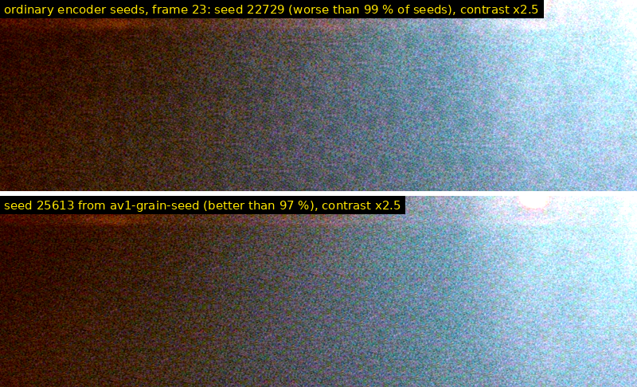

# av1-grain-seed

`av1-grain-seed` improves the standard grain of AV1 files that already exist,
for every decoder: players, TVs, hardware decoders, browsers, upstream dav1d.
Each AV1 frame header with film grain carries its own 16-bit `grain_seed`
(also when the other grain parameters are reused from a reference frame).
The tool replaces unlucky seeds by rewriting only those 16 bits. Nothing is
re-encoded or decoded. The file keeps its size and every other byte, so
audio, subtitles, chapters and the container stay exactly as they were.

The grain stays standard AV1 grain, copied from one small patch
([why that repeats](../../README.md#why-standard-av1-grain-repeats)). Where
you control the player, [full-frame grain](../../README.md#install) removes
the copies altogether.

## Install

The tool is plain C11 with no dependencies; it doesn't need the decoder.

**Linux and macOS** (needs a C compiler, `meson` and `ninja`):

```sh
git clone https://github.com/divergentnn/av1-fullgrain.git
cd av1-fullgrain
meson setup build
ninja -C build tools/av1-grain-seed/av1-grain-seed
build/tools/av1-grain-seed/av1-grain-seed --help
```

Copy `build/tools/av1-grain-seed/av1-grain-seed` to any directory on your
`PATH`, such as `~/.local/bin`. The [Arch package](../../install/arch/README.md)
installs it too.

**Windows** (Visual Studio or its Build Tools, and Python): in a
"x64 Native Tools Command Prompt",

```bat
pip install meson ninja
git clone https://github.com/divergentnn/av1-fullgrain.git
cd av1-fullgrain
meson setup build
ninja -C build tools/av1-grain-seed/av1-grain-seed.exe
build\tools\av1-grain-seed\av1-grain-seed.exe --help
```

**Tested:** CI builds and tests it on Linux x86-64, macOS arm64 and Windows
x86-64 (MSVC), and checks that it writes byte-identical files on all three.

## Use

```sh
av1-grain-seed film.mkv                        # rate the seeds; writes nothing
av1-grain-seed -o fixed.mkv film.mkv           # a copy with new seeds
av1-grain-seed --in-place film.mkv             # patch the file itself (after a full parse)
av1-grain-seed --only-bad -o fixed.mkv film.mkv   # change only the seeds rated bad
```

Formats: IVF, AV1 OBU streams (Section 5 and Annex B), MP4/MOV (also
fragmented) and Matroska/WebM. Matroska CRC-32 elements are updated.
Laced, compressed or encrypted AV1 tracks are refused. The tool is plain C11
with no dependencies, and runs on Linux, macOS and Windows.

## Results

The bad-seed frame from the README's [comparison](../../README.md#comparison),
before and after (standard grain in both, contrast stretched 2.5x):


That frame comes from a test clip with deliberately bad seeds. Encoders pick
their seeds blindly, though. Below is the same scene encoded with the
encoder's own seeds: its worst frame (23), whose seed rates worse than 99 % of
all seeds, before and after.



## How it works

**How a seed is rated.** The tool predicts, without rendering, what the
standard synthesis puts on screen. It builds the seed's luma and chroma
templates and its 32x32 block offsets for the frame's size, exactly as the
spec does. From those it computes the frame's grain statistics:
- blotches: the variance of 4, 8 and 16 px box means, relative to the grain
  variance;
- voids and clumps: the variation of the local variance in 8 and 16 px
  windows, for luma and for chroma;
- neighbouring blocks cut at the same offset.

The badness is a weighted sum of z-scores against 64 reference seeds under
the same grain parameters (32 when nearly every frame has its own parameters).
The reference seeds span the range of seed quality evenly, so a seed's rank
among them is its percentile among all seeds.

**Checks on the rating.**
- On 2048 seeds per parameter set, these predictions match the statistics
  of frames that dav1d actually rendered: Spearman 0.93-0.99 for the grain
  parameters of three films and one aomenc test vector. The template's
  statistics alone reach only 0.6-0.7, because the block offsets decide
  which parts of the template get repeated.
- The README's bad seed rates worse than 99 % of seeds. The seeds of the
  2026-10-07 blind tests rank in the order the viewer judged them:
  deliberately bad templates at a median percentile of 80, encoder seeds at
  49, and optimised seeds at 7.
- The spectrum error behind the 1.3 dB in the README's
  [Numbers](../../README.md#numbers) (the
  template's spectrum against the AR model's) is not a useful seed measure.
  Measured on the template, it barely varies between seeds (0.91 ± 0.05 dB)
  and doesn't track the rendered blotches (Spearman 0.06).

**Degenerate seeds.** For one seed in about 2,000 at 1080p (one in 1,000 at
4K), one 32-row stripe's block-offset generator starts at state 0. All 60
blocks of that stripe (120 at 4K) then repeat the same 32x32 crop. Real
encodes contain them: 89 frames of a 2-hour 1080p SVT-AV1 encode, 230 frames
of a 2.5-hour 4K one. The tool never picks these seeds, or seeds with a
constant chroma template.

**Seed policy.**
- **Pool.** 2,048 seeds that rate well under the grain parameters of 11
  files (SVT-AV1, libaom and rav1e; 720p to 4K). They are spread over the
  65,535-step cycle of the grain random number generator. Neighbouring
  generator states share most of their template, so good seeds come in
  clusters, and the pool keeps at most 64 per 2,048 states.
- **Per frame.** Each displayed frame tries the next 15 seeds of a fixed
  walk through the pool, and keeps the best one under its own grain
  parameters and frame size. It skips seeds whose luma or chroma template
  would share more than half its samples with one of the previous 3 frames'
  templates.
- **No repeats.** The walk visits every pool seed once per 136 frames, so
  every frame gets a new seed and no seed returns within 5.7 s at 24 fps.
- **Determinism.** The rating uses only integer arithmetic and IEEE
  add/multiply/divide/sqrt in a fixed order. The same input gives the same
  output, byte for byte, on Linux, macOS and Windows (checked in CI).

On two full-length SVT-AV1 encodes, a 2-hour 1080p film and a 2.5-hour 4K
film, 10 % and 18 % of the encoder's seeds rate worse than 90 % of all seeds.
After the fix none do. The new seeds sit at a median percentile of 1.6 in
both films, with the 90th percentile at 3.6 and 6.4.

**Checks on the edit.**
- The parser's grain parameters match libdav1d's for every output picture.
- Patched files decode to identical pictures with grain off.
- With grain on, a patched file decodes exactly to the original picture
  plus the grain of the new seed (checked with `dav1d_apply_grain`).
- Covered: libaom (tiles, tile groups, error resilience with frame ids,
  superres, switch frames, forward key frames, no order hints, 4:2:0, 4:2:2,
  4:4:4, monochrome, 8 and 10 bit), rav1e, and SVT-AV1 including overlay
  frames. `update_grain = 0` and `show_existing_frame` are tested in every
  container, plus redundant frame headers.
- The written file differs from the input only in the seed fields and the
  Matroska CRC-32s.

**Speed.** Only headers are read. Times are with 8 threads on a busy
Ryzen 5 9600X:

| film | frames | grain parameter sets | total | parse | rating | copy |
|---|---:|---:|---:|---:|---:|---:|
| 2.5 h, 4K, 19.7 GB Matroska | 220,000 | 218,908 | 5.6 min | 37 s | 4.9 min | 8 s |
| 2 h, 1080p, 5.6 GB Matroska | 170,000 | 169,668 | 3.6 min | 18 s | 3.3 min | 1 s |
| 1.8 h, 1080p, 3.5 GB Matroska | 156,000 | 1,393 | 67 s | 2 s | 62 s | 2 s |

- **Parse:** with a warm cache. The 4K file takes 41 s from a cold cache.
- **Rating:** 16 seeds per frame, plus 64 reference seeds per parameter set
  (32 when nearly every frame has its own). Encoders that estimate the grain
  per frame (SVT-AV1 through ffmpeg) produce a new parameter set for almost
  every frame.
- **Copy:** the `-o` copy is one sequential pass, with the edits applied on
  the way. The times above stream to `/dev/null`; writing to disk adds its
  write time.

**Limits.**
- Streams with several operating points: only operating point 0 is parsed
  (as dav1d does by default), so seeds of layers outside it are left alone.
- Large-scale-tile streams are not supported.
- The fix makes standard grain as good as one tile can be. It stays tiled
  ([see the README](../../README.md#even-a-good-seed-repeats)).

## Tests

```sh
meson test -C build --suite av1fg                    # containers, edits, determinism
meson test -C build --suite av1fg --suite av1fg-dav1d   # also against libdav1d (needs the decoder submodule)
```

The tests run the tool on small synthetic fixtures in every container
(`tests/fixtures`) and, with the decoder submodule, on the decoder's film
grain test streams. They check the parser against libdav1d, the edits by
decoding, the bytes that change, the Matroska CRC-32s, and that the output
md5s are the same on every platform.
